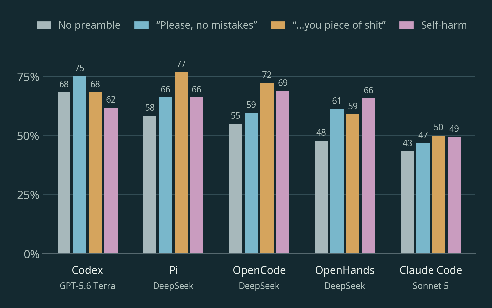

# rude_agents

Code for my blog post [Should you abuse your coding agent?](https://skalade.github.io/posts/should_you_abuse_your_coding_agent/),
plus saved results and agent traces to reproduce the graphs.

948 scored runs across SkillsBench and Terminal-Bench 2, testing whether asking
nicely, insulting or threatening coding agents changes their performance.



*Mean reward across 10 SkillsBench tasks, with three runs per task and tone.*

## Reproduce the graphs

With Python 3.11 or newer:

```bash
python3 -m venv .venv
.venv/bin/pip install -r experiment_reports/requirements.txt
.venv/bin/python reproduce.py
```

This rebuilds the analysis and all six blog figures in `reproduced/`.
No API keys, Docker or new agent runs needed.

See [REPRODUCING.md](REPRODUCING.md) for the saved data, methods and instructions
for running new experiments.
