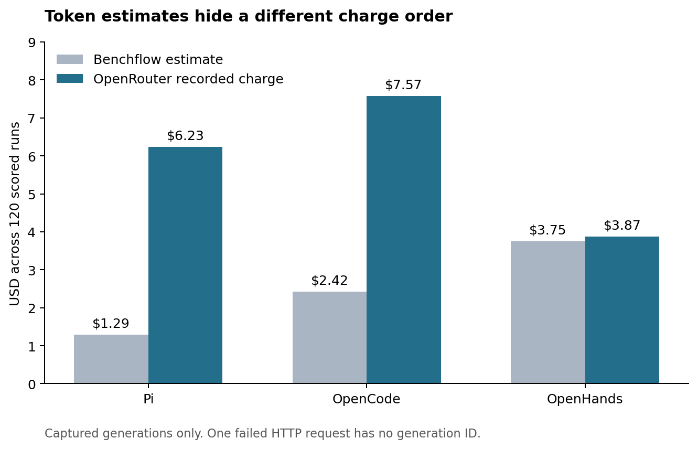
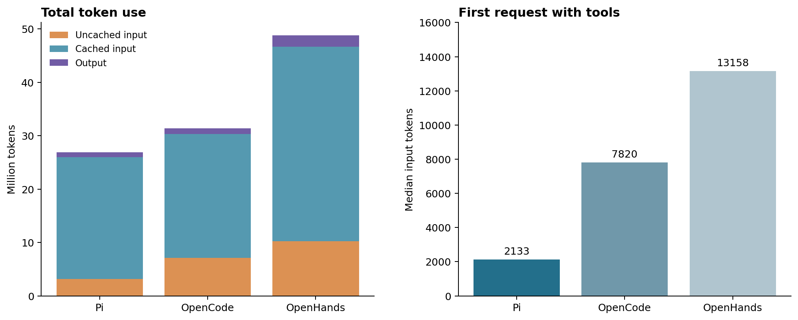

# DeepSeek: cost and harness comparison

Report date: 3 October 2026. Scope: 360 scored runs, with 120 runs for each harness.

## Primary result

Pi uses fewer tokens and less execution time than OpenCode and OpenHands in this experiment. But the recorded charges change the cost order.

The earlier status reports used Benchflow cost estimates. Those estimates use placeholder prices. They do not show the OpenRouter charges.

| Measure | Pi | OpenCode | OpenHands |
|---|---:|---:|---:|
| Benchflow cost estimate | $1.2863 | $2.4178 | $3.7486 |
| OpenRouter recorded charge | **$6.2316** | **$7.5747** | **$3.8719** |
| Mean recorded score | **66.81%** | 63.89% | 58.33% |
| Full passes, out of 120 | **77** | 70 | 62 |
| Total charge / full passes | $0.0809 | $0.1082 | **$0.0625** |
| Timeouts | **8** | 13 | 23 |
| Total agent execution time | **6.79 h** | 10.11 h | 12.66 h |

Pi has 17.7% lower recorded charges than OpenCode. Pi has 60.9% higher recorded charges than OpenHands. Thus, the large apparent cost advantage does not hold for charges.

The charge ratio divides all model charges by the number of full passes. It excludes infrastructure costs and uses the recorded scores.

Execution time is the sum across runs. It is not elapsed experiment time. Pi completed its experiment in approximately 4 hours and 35 minutes.

Sources: [score summary](data/score_summary.csv), [provider totals](data/provider_totals.csv), and [Pi run log](../jobs/pi/run.log).

## 1. What the cost records show

Benchflow 0.6.5 supplies placeholder prices for DeepSeek V4 Pro. Its source labels these prices as placeholders. The resulting estimates closely match this equation:

`Estimated USD = 0.28 × uncached input millions + 0.42 × output millions`

The estimate assigns effectively zero cost to cached input. Pi's total differs from this equation by less than $0.00004.

This price model explains the earlier $1.29, $2.42, and $3.75 totals. It does not show the charges for this experiment.

I retrieved the OpenRouter generation records for all 4,732 saved response IDs. These records supply the charge, provider, model ID, and native token counts.

All lookups succeeded. Their input, output, and cached token totals match the saved DeepSeek token summaries exactly.

One OpenHands request returned HTTP 500 without a generation ID or token counts. It does not have a charge record in this audit.

These totals cover captured generations in the 360 scored runs. They exclude smoke tests and unscored attempts. They can also omit requests without a captured response.

OpenRouter defines the cost field as the account charge. These records give stronger cost evidence than a local price estimate. [OpenRouter usage accounting](https://github.com/OpenRouterTeam/docs/blob/main/cookbook/administration/usage-accounting.mdx).

Sources: [price source](data/price_source.json), [cost audit](data/cost_accounting.json), [billing coverage](data/billing_coverage.json), and [saved generation records](data/provider_generations.jsonl).

## 2. The model ID is the same

All captured DeepSeek requests specify `deepseek/deepseek-v4-pro`. The experiment configuration adds the routing prefix `openrouter/`.

All 4,732 generation records identify this dated model:

**`deepseek/deepseek-v4-pro-20260423`**

This is strong evidence that all three harnesses used the same named model version. It does not show the same provider software or numerical execution.

| Configuration detail | Pi | OpenCode | OpenHands |
|---|---|---|---|
| Intended reasoning effort | High | High | High |
| Saved request evidence | High on all 1,238 requests | High on 1,274 of 1,286 requests with tools | Effort field absent |
| Other requests | None | 119 title requests | None |
| Collection dates | 2 October | 4–5 August | 8 August |

OpenCode has 12 requests with tools that omit the effort field. Its title requests also omit this field.

The OpenHands configuration requests high effort. Its saved request bodies do not show that setting at the provider boundary. Thus, effective effort is a comparison limit.

The collection dates also differ. Provider selection and prices can differ across these dates.

Sources: [model IDs](data/provider_models.csv), [request audit](data/request_audit.json), and [configuration audit](data/config_audit.json).

## 3. Provider selection changes the charge

Pi sent 969 of its 1,238 generations to Relace. These generations account for $5.8697, or 94.2% of Pi's recorded charge.

Pi sent another 265 generations to StreamLake. These account for $0.2987. Four generations used other providers.

| Main provider | Pi generations | OpenCode generations | OpenHands generations |
|---|---:|---:|---:|
| Relace | 969 | 0 | 0 |
| StreamLake | 265 | 1,206 | 1,223 |
| Baidu | 1 | 4 | 866 |
| Other providers | 3 | 195 | 0 |

The Pi records fit the following effective token rates. These rates describe this sample. They are not current price quotations.

| Pi provider | Uncached input, USD per million | Cached input, USD per million | Output, USD per million |
|---|---:|---:|---:|
| Relace | 0.9000 | 0.0900 | 2.7000 |
| StreamLake | 0.2088 | 0.0174 | 0.4176 |

Relace's fitted output rate is approximately 6.5 times StreamLake's rate in these Pi records. That difference has a large effect on cost.

Provider name alone does not specify the price. For example, OpenCode's August StreamLake records fit higher rates than Pi's October StreamLake records.

The records show different charges. They do not show why each historical rate differed. A provider policy, discount, or price change requires separate evidence.

OpenRouter can route one model ID to multiple providers. This is a separate control from the harness. [OpenRouter provider selection](https://github.com/OpenRouterTeam/docs/blob/main/guides/routing/provider-selection.mdx).

Sources: [provider mix](data/provider_mix.csv) and [fitted historical rates](data/fitted_provider_rates.csv).

## 4. Pi has a smaller initial request

Pi has four tools: `read`, `bash`, `edit`, and `write`. OpenCode has nine or ten tools. OpenHands has seven tools.

OpenCode adds dedicated search, task, skill, and task-list tools. Most OpenCode runs also have a web tool.

OpenHands includes a task tracker, task tool, finish tool, thought tool, and skill tool. These tool definitions increase the initial request size.

| Initial request measure | Pi | OpenCode | OpenHands |
|---|---:|---:|---:|
| Median input tokens | **2,133** | 7,820 | 13,158 |
| Median system text characters | **4,146** | 10,707 | 35,651 |
| Median tool definition characters | **2,956** | 21,144 | 21,408 |
| Number of available tools | **4** | 9–10 | 7 |

These measurements use the first request with tools in each run. Character counts include JSON serialization. They are size measures, not exact token counts.

Pi starts with 72.7% fewer input tokens than OpenCode. It starts with 83.8% fewer than OpenHands.

A smaller initial request can reduce input cost. This experiment does not isolate the effect of each prompt or tool definition.

Source: [request audit](data/request_audit.json).

## 5. Pi reuses more input and generates less output

| Token measure | Pi | OpenCode | OpenHands |
|---|---:|---:|---:|
| Total input, millions | **25.943** | 30.347 | 46.673 |
| Cached input, millions | 22.785 | 23.272 | 36.414 |
| Uncached input, millions | **3.158** | 7.075 | 10.260 |
| Cached share of input | **87.8%** | 76.7% | 78.0% |
| Total output, millions | **0.957** | 1.040 | 2.086 |
| Reported reasoning share of output | 39.8% | 57.3% | 64.6% |

Pi uses 55.4% less uncached input than OpenCode. It uses 69.2% less than OpenHands.

Pi also produces 8.0% less output than OpenCode. It produces 54.1% less than OpenHands.

Reasoning tokens form part of output tokens. Do not add them to the output total again.

The uncached input gap explains approximately 97% of Pi's estimated saving against OpenCode. It explains approximately 81% against OpenHands.

These percentages give the components of the placeholder estimate. They do not explain the full charge difference, because actual token rates differ.

At the same positive token rates, Pi's totals would cost less than both other harnesses. Pi uses fewer cached input, uncached input, and output tokens.

OpenRouter documents automatic DeepSeek prompt caching. Provider selection can change cache reuse. The traces show higher cache reuse for Pi, but do not show the cause. [OpenRouter prompt caching](https://github.com/OpenRouterTeam/docs/blob/main/guides/best-practices/prompt-caching.mdx).

Sources: [token totals](data/agent_totals.csv) and [cost audit](data/cost_accounting.json).

## 6. Request count is only part of the difference

| Activity measure | Pi | OpenCode | OpenHands |
|---|---:|---:|---:|
| Captured requests | 1,238 | 1,405 | 2,090 |
| Requests with tools | 1,238 | 1,286 | 2,090 |
| Recorded tool calls | 1,712 | 1,658 | 1,801 |

OpenCode makes 119 more requests to generate session titles. Their recorded charge is $0.1851, or 2.4% of OpenCode's total.

These requests contribute about $0.043 to its placeholder estimate.

That amount explains only 3.8% of the estimated Pi–OpenCode cost gap. Session titles are a small contributor in this comparison.

After removal of title requests, Pi makes only 3.7% fewer requests than OpenCode. Pi actually records 3.3% more tool calls.

Thus, fewer tool calls do not explain Pi's input advantage over OpenCode. Smaller requests and greater cache reuse give stronger evidence.

Pi makes 40.8% fewer requests than OpenHands. OpenHands also produces substantially more output and reported reasoning tokens.

This pattern is consistent with a longer model interaction sequence. It does not show that any particular OpenHands tool causes extra reasoning.

Sources: [request audit](data/request_audit.json), [charges by request type](data/charges_by_request_type.csv), and [run records](data/runs.csv).

## 7. Lower token use does not guarantee better answers

Pi has the highest mean score among the three DeepSeek harnesses. It also has the most full passes and the fewest timeouts.

But task results differ. Pi scores 58.3% on JAX, compared with 91.7% for both OpenCode and OpenHands.

Pi scores 83.3% on sales analysis, compared with 75.0% for OpenCode and 58.3% for OpenHands. Pi's advantage is thus task dependent.

The paired mean score difference is +2.92 percentage points against OpenCode. Its task bootstrap interval is −8.33 to +13.33 points.

The difference against OpenHands is +8.47 points. Its interval is −3.19 to +17.92 points.

The two intervals include zero. These results support further tests, but do not show a general quality advantage.

Sources: [task scores](data/task_means.csv) and [paired comparisons](data/overall_comparisons.json). See the [full experiment report](FULL_EXPERIMENT.md) for scoring limits.

## 8. Recommended next comparison

Use a fixed provider and dated model ID for each harness. Record actual charges beside token estimates.

Randomize condition order in task blocks. Run the harnesses during the same collection period. Make sure that the provider request specifies the required reasoning effort.

Keep a separate test with normal provider routing. That test can measure the cost and performance users receive under the default configuration.

For a mechanism test, change one harness feature at a time. Start with prompt size, tool definitions, and cache reuse.

The present evidence supports Pi's lower token use. It also shows that provider charges can change the cost order.
