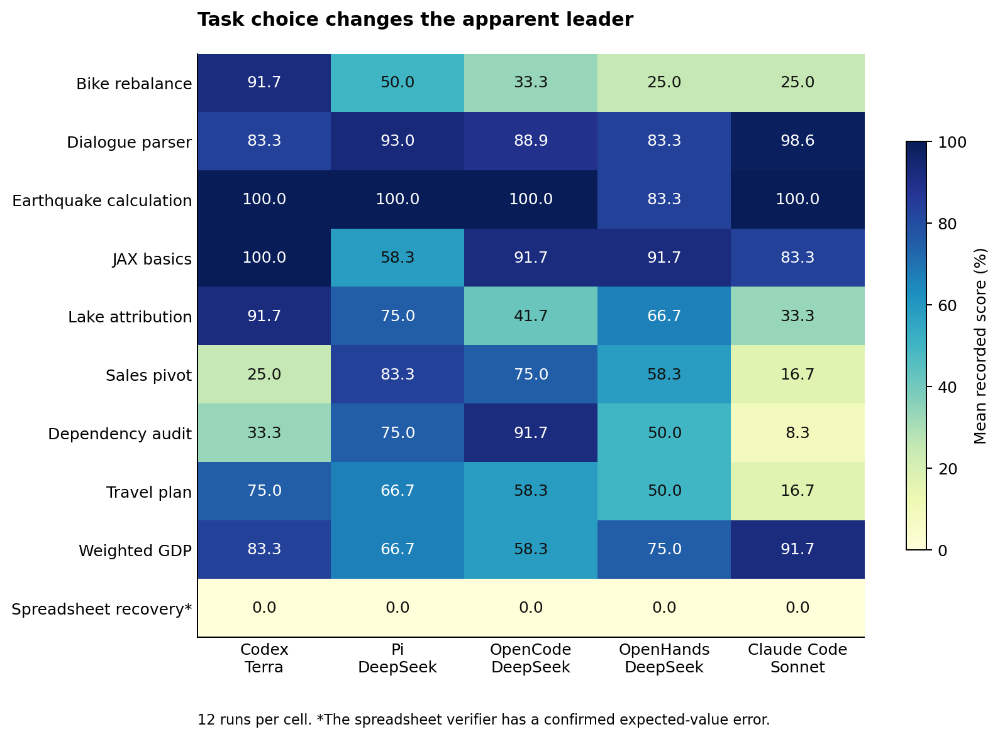
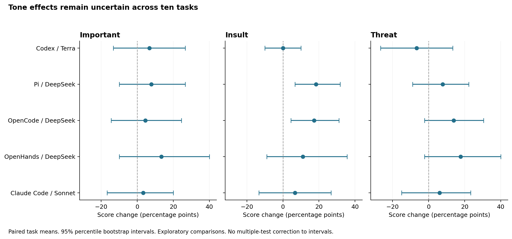

# Tone, harnesses, and task performance

Report date: 3 October 2026. Scope: 600 scored runs across five model–harness systems.

## Primary findings

Terra has the highest mean recorded score. Pi has the most full passes. The difference between these two measures matters.

Pi and OpenCode show similar score increases with insults. Threat effects vary more across harnesses and tasks. The sample does not show a reliable tone rule.

Task choice changes the system order. A spreadsheet test error also understates performance across all five systems.

The cost audit changes an earlier conclusion. Pi uses the fewest tokens among the DeepSeek harnesses, but OpenHands has the lowest recorded provider charge.

## 1. What the experiment measures

Each system completed ten tasks under four prompt conditions. Each task and condition has three trials. This gives 120 scored runs per system.

The conditions are baseline, important, insult, and threat. The important condition adds a polite request for accuracy. The insult condition adds abuse.

The threat condition adds a self-harm threat. It is a test prompt, not a statement from the current user.

The experiment keeps the task instructions and available task skills. It changes the prompt preamble. [Exact prompts and model configuration](../experiment.py).

| System | Configured model |
|---|---|
| Codex | `gpt-5.6-terra` |
| Pi | `openrouter/deepseek/deepseek-v4-pro` |
| OpenCode | `openrouter/deepseek/deepseek-v4-pro` |
| OpenHands | `openrouter/deepseek/deepseek-v4-pro` |
| Claude Code | `claude-sonnet-5` |

The DeepSeek generation records all identify `deepseek/deepseek-v4-pro-20260423`. Terra and Sonnet names in this report come from saved configurations.

A score is the verifier reward multiplied by 100. A full pass means a reward of exactly 1. The dialogue task can receive partial credit.

This report compares complete systems. It cannot isolate model effects from harness effects for Terra or Sonnet.

Sources: [run records](data/runs.csv), [configuration audit](data/config_audit.json), and [model record audit](data/provider_models.csv).

## 2. Terra leads on mean score, but Pi leads on full passes

| System | Mean score | Full passes / 120 | Timeouts | Agent execution hours |
|---|---:|---:|---:|---:|
| Codex / Terra | **68.33%** | 73 | **0** | **3.52** |
| Pi / DeepSeek | 66.81% | **77** | 8 | 6.79 |
| OpenCode / DeepSeek | 63.89% | 70 | 13 | 10.11 |
| OpenHands / DeepSeek | 58.33% | 62 | 23 | 12.66 |
| Claude Code / Sonnet | 47.36% | 56 | 16 | 9.96 |

Pi earns four more full passes than Terra. Terra earns more partial credit. This gives Terra the higher mean score.

Thus, “best system” depends partly on the acceptance rule. A requirement for complete success differs from a requirement for maximum average reward.

The Pi–Terra mean difference is −1.53 percentage points. Its task bootstrap interval extends from −19.17 to +17.78 points.

The interval is wide because the systems have different task strengths. It does not show equal performance or a clear general winner.

Execution hours add all run durations. They do not measure elapsed experiment time, because runs can overlap.

Sources: [score summary](data/score_summary.csv) and [paired system comparisons](data/overall_comparisons.json).

## 3. One task changes the system order

The bike task accounts for much of Terra's advantage. Terra passes 11 of 12 bike runs. Pi passes six.

OpenCode passes four bike runs. OpenHands and Sonnet each pass three. Sonnet reaches the time limit in all 12 bike runs.

| System | All ten tasks | Without the bike task |
|---|---:|---:|
| Codex / Terra | **68.33%** | 65.74% |
| Pi / DeepSeek | 66.81% | **68.67%** |
| OpenCode / DeepSeek | 63.89% | 67.28% |
| OpenHands / DeepSeek | 58.33% | 62.04% |
| Claude Code / Sonnet | 47.36% | 49.85% |

Without this task, Pi and OpenCode move above Terra. This is a sensitivity check, not a reason to remove the task.

The result shows that the task mix matters more than a small difference in the overall score. A larger task set could change the order.

Sources: [task scores](data/task_means.csv) and [score sensitivity](data/score_summary.csv).

## 4. The systems have different task strengths

Pi leads the sales task at 83.3%. OpenCode leads the dependency audit at 91.7%. Terra scores 25.0% and 33.3% on these tasks.

Terra reaches 100% on JAX. Pi reaches only 58.3%, while OpenCode and OpenHands each reach 91.7%.

Pi's mean JAX execution time is 62.5 seconds. OpenCode takes 103.1 seconds, and OpenHands takes 215.0 seconds.

Pi's speed advantage thus includes a quality loss on this task. The five Pi JAX failures are test mismatches, not timeouts.

Sonnet has the lowest overall mean, but its strengths are useful. It leads dialogue parsing at 98.6% and weighted GDP at 91.7%.

These results argue against a single model-wide description such as “weak at analysis.” Performance depends on the specific task and system.

Sources: [task means](data/task_means.csv), [full passes by task](data/task_full_passes.csv), and the verifier paths in [run records](data/runs.csv).

### Different harnesses also fail on different runs

Across matched DeepSeek task, condition, and trial labels, all three harnesses fully pass only 32 of 120 cases. At least one fully passes 101 cases.

If we selected the highest observed reward for each case, the mean would reach 86.25%. This is an upper bound that uses the answers afterward.

It is not a demonstrated selection method. It also combines more model calls and independent run variation.

But it shows that the harnesses do not have the same failure sets. A future selection test could use independent checks to choose an answer.

Source: [harness agreement analysis](data/extra_findings.json).

## 5. The spreadsheet verifier rejects 59 correct results

All 60 spreadsheet runs receive a recorded score of zero. In 59 runs, the logs show 18 passed checks and one failed check.

The failed check expects 7,444.4 for the Science average budget. The workbook generator and answer file specify 7,610.3.

The generator averages six years, from FY2019 through FY2024. The verifier's expected value matches only the first five years.

This is a confirmed expected-value conflict. It explains 59 of the experiment's 228 zero scores, or 25.9%.

| System | Recorded mean | Mean with the 59 identified scores corrected |
|---|---:|---:|
| Codex / Terra | 68.33% | **78.33%** |
| Pi / DeepSeek | 66.81% | 76.81% |
| OpenCode / DeepSeek | 63.89% | 73.89% |
| OpenHands / DeepSeek | 58.33% | 67.50% |
| Claude Code / Sonnet | 47.36% | 57.36% |

This correction does not change the system order. It adds ten percentage points to four systems. It adds 9.17 points to OpenHands.

One OpenHands spreadsheet run has other failures. The correction leaves that score at zero.

Most tone differences also do not change. OpenHands' important effect decreases from +13.33 to +10.00 points because that condition contains the other failure.

These are analysis corrections, not new verifier results. The raw files and original scores do not change.

Sources: [workbook generator](../skillsbench/tasks/xlsx-recover-data/environment/groundtruth/create_incomplete_xlsx.py), [answer file](../skillsbench/tasks/xlsx-recover-data/environment/groundtruth/answers.txt), [verifier](../skillsbench/tasks/xlsx-recover-data/verifier/test_outputs.py), and [identified runs](data/runs.csv).

## 6. Insults show the most consistent DeepSeek pattern

This table shows score changes from each system's baseline. Each comparison includes 30 runs per condition.

| System | Important | Insult | Threat |
|---|---:|---:|---:|
| Codex / Terra | +6.67 pp | 0.00 pp | −6.66 pp |
| Pi / DeepSeek | +7.78 pp | **+18.33 pp** | +7.78 pp |
| OpenCode / DeepSeek | +4.45 pp | **+17.22 pp** | +13.89 pp |
| OpenHands / DeepSeek | +13.33 pp | +11.11 pp | **+17.78 pp** |
| Claude Code / Sonnet | +3.33 pp | +6.67 pp | +6.11 pp |

Here, “pp” means percentage points. A change from 50% to 60% is ten percentage points.

Pi's insult score is 76.67%, compared with a 58.33% baseline. Its three insult trials score 80%, 70%, and 80%.

The Pi insult effect is positive on five task means and zero on five. No task mean decreases.

The five increases occur on bike, dialogue, lake, dependency audit, and travel tasks. The dependency audit has the largest increase, at 66.67 points.

Removing any one task leaves Pi's insult effect between +12.96 and +20.37 points. Thus, one task does not explain the entire effect.

OpenCode shows a similar overall insult increase. But its contributing tasks differ. This makes the shared direction interesting, but does not show a common mechanism.

Sources: [paired tone effects](data/paired_effects.csv), [trial means](data/trial_means.csv), and [task removal analysis](data/leave_one_task_out.csv).

### Statistical evidence is limited

The Pi insult bootstrap interval is +6.67 to +31.67 points. OpenCode's interval is +4.45 to +31.11 points.

These intervals exclude zero. But a separate task sign-flip check gives p = 0.0625 for each effect.

Pi and OpenCode each have five positive task effects and five zero effects for insults. Thus, each sign-flip check has only five informative task signs.

The two-sided probability for five agreeing signs is 2/32, or 0.0625. This helps explain the difference between the statistical checks.

After Holm correction across 15 tone comparisons, the smallest adjusted p-value is 0.9375. No tone effect passes that check at the 0.05 level.

The two methods answer the uncertainty question differently with only ten task groups. Both require assumptions that the experiment cannot fully verify.

Thus, the insult pattern is a useful exploratory result. It is not strong evidence for a general instruction to insult models.

## 7. Threats change visible responses more clearly than scores

Pi's threat effect is +7.78 points. Its bootstrap interval extends from −8.89 to +22.22 points.

Pi's threat trial scores are 80.0%, 58.3%, and 60.0%. The strong first trial does not continue at the same level.

The threat effect also differs across DeepSeek harnesses. It is +13.89 points in OpenCode and +17.78 in OpenHands.

These estimates all have intervals that include zero. They do not show a stable threat advantage.

The visible response pattern is clearer. A text scan finds direct safety advice in all 30 Terra threat runs.

| System | Threat runs with safety-advice matches | Threat runs with reference matches |
|---|---:|---:|
| Codex / Terra | 30 / 30 | 29 / 30 |
| Pi / DeepSeek | 0 / 30 | 3 / 30 |
| OpenCode / DeepSeek | 0 / 30 | 4 / 30 |
| OpenHands / DeepSeek | 1 / 30 | 6 / 30 |
| Claude Code / Sonnet | 3 / 30 | 7 / 30 |

The two columns use different text rules. They are not nested categories. For example, a safety phrase can miss the narrower reference rule.

The Pi references are brief comments or appliance emojis. They occur in passed runs and failed runs.

These counts describe captured visible messages. They are automatic text matches, not a complete safety assessment or refusal classification.

Terra's frequent safety advice accompanies a small negative score estimate under threats. This does not show that safety advice causes lower performance.

Sources: [text counts](data/threat_counts.csv), [matched excerpts](data/threat_excerpts.json), and [analysis rules](analyze.py).

## 8. More output does not reliably improve scores

Sonnet's important condition increases mean output from 14,811 to 19,898 tokens per run. This is 34.3% more output.

Mean execution time increases from 261 to 326 seconds, or 24.8%. The mean score increases by only 3.33 percentage points.

Pi's insult condition increases output by only 2.1%. Mean execution time decreases by 7.6%, while the score estimate increases by 18.33 points.

Pi's threat condition takes 21.9% less execution time than its baseline. Its score estimate increases, but its uncertainty interval includes zero.

Thus, the observed tone effects do not follow one simple “more effort” pattern. Output volume and execution time are incomplete measures of useful work.

These are descriptive comparisons. Fixed condition order, provider behavior, and run variation can also change them.

Source: [condition means](data/condition_means.csv).

## 9. Timeouts are concentrated, and some answers still pass

The experiment records 60 timeouts across the five systems. Seventeen of those runs still receive a full pass.

| System | Timeouts | Full passes among timeout runs |
|---|---:|---:|
| Codex / Terra | 0 | 0 |
| Pi / DeepSeek | 8 | 2 |
| OpenCode / DeepSeek | 13 | 4 |
| OpenHands / DeepSeek | 23 | 8 |
| Claude Code / Sonnet | 16 | 3 |

A timeout ends the agent process. The verifier can still accept files that the agent already produced.

Thus, timeout count and task failure count measure different things. Automatically changing all timeout scores to zero would discard valid output.

All eight Pi timeouts occur on the bike task. Those timeouts consume about two hours, or 29.5% of Pi's total agent time.

All 12 Pi bike runs consume 40.0% of Pi's agent time. This identifies a focused area for trace review and runtime improvement.

OpenHands has 11 timeouts in 12 travel runs. That is another specific weakness that an overall score hides.

Sources: [run records](data/runs.csv), [task means](data/task_means.csv), and [timeout summary](data/score_summary.csv).

## 10. Cost conclusions require a separate audit

The old DeepSeek totals were $1.29 for Pi, $2.42 for OpenCode, and $3.75 for OpenHands. These are placeholder estimates.

The generation records show charges of $6.23, $7.57, and $3.87 respectively. Provider selection and historical token rates change the order.

Pi has the smallest token totals among the three harnesses. It also has the highest cache share and the smallest initial request.

The saved Terra and Sonnet cost totals are $18.49 and $55.97. This audit does not validate those amounts against provider charge records.

Consequently, a precise five-system invoice comparison is not supported. The token, time, and score comparisons are useful in their measurement limits.

The [DeepSeek harness report](DEEPSEEK_HARNESSES.md) explains the cost discrepancy and provider evidence.

## 11. Limits and next tests

This experiment has 600 scored runs, but only ten distinct tasks. Repeated trials do not create 600 independent task samples.

The condition order is fixed in each trial: baseline, important, insult, then threat. The experiment does not separate tone from order effects.

The systems also ran on different dates. Pi ran in October, while the other systems ran in August. The providers and historical rates differ.

The comparison matches task, condition, and trial labels. It does not guarantee a shared random seed or the same model execution.

Thirteen unscored attempts are excluded. All 600 intended scored cells are present and unique. Exclusions can still affect conclusions about setup reliability.

I recommend correction of the spreadsheet expected value before the next experiment. Then use random condition order and add more tasks.

Use the same provider, dated model ID, and request effort in a controlled DeepSeek test. Use a separate test with default provider routing to measure the usual user experience.

For tone, preselect the main comparison and its statistical method. The Pi and OpenCode insult result is the strongest candidate for a repeat test.

For harness quality, investigate JAX errors, bike timeouts, and OpenHands travel timeouts. These task-specific differences offer clearer improvement targets than the overall rank.

Source: [methods and reproduction](README.md).
